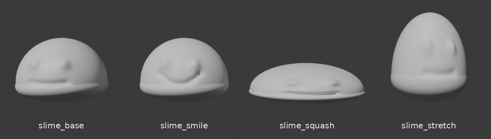

# HW05: Shape Keys from OBJ Files (Slime)

**DT475 Animation and Modeling · Blender 5.2 + Python (bpy) · Weight: __ % · Effort: about 2–4 hours · Due: Tue 15 Dec 2026**

You get a slime as four OBJ files: the rest shape plus a squashed, a stretched and a smiling copy. OBJ cannot store shape keys, so **your script rebuilds them**, animates a jump with squash and stretch, links the smile to a control bone, and exports a GLB that a game engine can read. At the end you open the GLB yourself and count its morph targets.

## Learning outcomes

| | Outcome | Where |
|---|---|---|
| LO1 | Explain a shape key as *one stored position per vertex* and use Mix = Basis + Σ wᵢ(Sᵢ − Basis) | Task 1, Q1–Q2 |
| LO2 | Animate shape-key values with keyframes (squash and stretch) | Task 2 |
| LO3 | Drive a shape key from a bone, and say when to use a driver instead of keys | Task 3, Q3 |
| LO4 | Say which file formats keep shape keys, and read a GLB file's structure | Task 4, Q4 |

## Files

| File | What it is |
|---|---|
| `hw05_main.py` | **The only file you edit.** Five functions marked `TODO`. |
| `hw05_helper.py` | Scene setup and the auto-check. Keep it next to `hw05_main.py`. You do not need to read it. |
| `models/` | `slime_base.obj`, `slime_squash.obj`, `slime_stretch.obj`, `slime_smile.obj` (12 434 vertices each, same order), `slime_wrong.obj` (different vertex count, used to test your error check) |
| `answers_template.md` | Copy to `answers.md` and fill in. |

## Get the files

Click **Code ▸ Download ZIP** on this page and unzip it, or `git clone https://github.com/bcc139/DT475_shapeKeys.git`. Keep the files together: `hw05_main.py`, `hw05_helper.py` and `models/` must stay in the same folder.

## How to run

1. Blender 5.2 → **Scripting** workspace → *Text ▸ Open* → `hw05_main.py` → **Alt+P**.
2. *Window ▸ Toggle System Console* shows the check report. Nothing crashes while you are still working: unfinished parts say `TODO`.
3. Headless, the same check your instructor runs:
   `C:\blender-5.2.2\blender.exe -b -P hw05_main.py`

Set `MODE = "BUILD"` to build the scene without the report, then press **Space** to watch the jump. To test Task 3, select `SlimeRig`, enter Pose Mode, select `Smile_Ctrl` and press **G Z**.

## Tasks (8.5 points auto-checked)

### Task 1: `add_shape_from_obj(base, path, name)` · 3.0 pt
Import a target OBJ, check that it has as many vertices as the base, add a shape key and copy every vertex position into it, then delete the imported object.

| Part | Pt | Check |
|---|---|---|
| 1a | 0.5 | The slime has keys `Basis, Squash, Stretch, Smile`, in that order |
| 1b | 1.5 | Every vertex of every key equals its OBJ file (read by the checker itself) |
| 1c | 1.0 | `slime_wrong.obj` raises `ValueError` (0.5) and leaves no extra object or key behind (0.5) |

Note: the OBJ importer keeps the file's Y-up numbers in the mesh and puts the Y-up → Z-up turn on the object as a 90° rotation. Because base and targets are imported the same way, copying `co` straight across is correct.

### Task 2: `animate_bounce(base)` · 2.0 pt
Key the jump in `helper.BOUNCE`:

| Frame | Squash | Stretch | Height | |
|---|---|---|---|---|
| 1 | 0 | 0 | 0 | rest |
| 6 | 1 | 0 | 0 | anticipation |
| 10 | 0 | 1 | 0.4 | take-off |
| 18 | 0 | 0 | 1.5 | top |
| 26 | 0 | 1 | 0.4 | falling |
| 30 | 1 | 0 | 0 | landing |
| 36 | 0 | 0 | 0 | settle |

2a (1.5): Squash and Stretch match at every listed frame. 2b (0.5): the height (`location.z`) matches.

### Task 3: `add_smile_driver(base, rig)` · 2.0 pt
The bone `Smile_Ctrl` drives `Smile`: bone local Y 0 → 0, 0.15 → 0.5, 0.3 or more → 1, below 0 → 0.

3a (1.5): five bone positions give the right Smile value. 3b (0.5): a *Transform Channel* variable on `Smile_Ctrl` and a **simple expression** (it then works without *Auto Run Python Scripts*).

### Task 4: `export_glb(path)` and `count_morph_targets(glb_path)` · 1.5 pt
Export `slime.glb` with morph targets and animation, then read the file **without Blender**: a 12-byte header, then a JSON chunk (length, `b"JSON"`, text). The docstring explains the bytes.

4a (1.0): `slime.glb` has 3 morph targets. 4b (0.5): your function counts the same number as the checker.

## Written answers · 1.0 pt (4 × 0.25)

In `answers.md`, in your own words:

1. **Same vertices.** Why must base and target have the same vertex count *and order*? What would the slime look like halfway (value 0.5) if the target's vertices were shuffled?
2. **Keys add up.** Set Squash = 1 and Stretch = 1 together. Use the formula on a vertex at the top of the slime (height h) and on its width. What do you get, and why? *(Squash: height × 0.6, width × 1.3. Stretch: height × 1.4, width × 0.82.)*
3. **Driver or keys?** Give one case in a game where a blend-shape weight should be driven by something (a bone or a gameplay value) instead of keyframed, and one where keyframes are better.
4. **Formats.** From the class formats lab: which formats kept the shape key, and why did the glTF import have more vertices than the original? Which format would you send to a game engine, and why?

## Grading (10 points)

| Item | Pt |
|---|---|
| Tasks 1–4 (check report) | 8.5 |
| Written answers | 1.0 |
| Code quality (readable, comments, no `bpy.ops.object.join_shapes`) | 0.5 |
| **Bonus**: retarget a different BVH clip (e.g. from the CMU mocap library) onto the class Robot with `retarget.py` and an updated `BONE_MAP`; submit the script and a short video or GIF | +1 |

The check you run is the one used for marking. A script that stops early loses the checks after the crash.

## Practice videos

Watch, then do the same in Blender. Most use Blender 2.8–4.x: the UI is close enough, but code that uses `action.fcurves` breaks in Blender 5.

| Topic | Video |
|---|---|
| Shape keys in the UI | [Shape Keys for Beginners (Blender Tutorial)](https://www.youtube.com/watch?v=Kumk-reupso) · [Blender Tutorial – Shape Key Basics](https://www.youtube.com/watch?v=7WGtmADZCzU) |
| Drive a key with a bone (Task 3) | [Control Shape Keys with Bones in Blender](https://www.youtube.com/watch?v=nGtCsHyyDtQ) · [Drive a Shape Key with a Bone](https://www.youtube.com/watch?v=yKYDgOkRAqY) |
| Shape keys from Python | [Color Slices Part 3 – Adding a Shape Key](https://www.youtube.com/watch?v=5cYn5WuyiWI) · [Part 4 – Animating a Shape Key](https://www.youtube.com/watch?v=e3eH1bq1D_U) |
| Mocap and retargeting (bonus) | [CGDive: Mocap & Retargeting in Blender #1](https://www.youtube.com/watch?v=Wm4me6ZZRk8) · [#3 Import FBX & BVH](https://www.youtube.com/watch?v=6IbNZl7Qcbw) · [Retargeting to "weird" Rigs](https://www.youtube.com/watch?v=ZfLU2NXWsUE) · [Free mocap files (CMU BVH)](https://www.youtube.com/watch?v=PG0qli4e82s) |
| File formats | [What is glTF?](https://www.youtube.com/watch?v=tonSNnEj-ow) · [Learn OpenUSD: What Are the USD File Formats?](https://www.youtube.com/watch?v=Cbx4EkjPe2A) |

## Submit

One folder named with your student ID: `hw05_main.py`, `answers.md`, and the bonus files if you did it. Do not submit the models.

## Troubleshooting

| Symptom | Fix |
|---|---|
| `ModuleNotFoundError: hw05_helper` | Open `hw05_main.py` from the folder that also holds `hw05_helper.py`. |
| `models/... not found` | Keep the `models` folder next to `hw05_main.py`. |
| Slime explodes into spikes | Vertex order mismatch: you copied from the wrong object, or copied into the Basis. |
| Smile does not move when you move the bone | Check the variable: armature **object** as `id`, bone name, `LOC_Y`, `LOCAL_SPACE`. Drivers update on the next redraw; move the bone again. |
| Driver works for you but shows an error elsewhere | The expression is not a *simple expression*: use only `+ - * /`, numbers, the variable and functions like `clamp`, `min`, `max`. |
| Changed the code but nothing changed | Save the text (**Alt+S**) and run again. |
